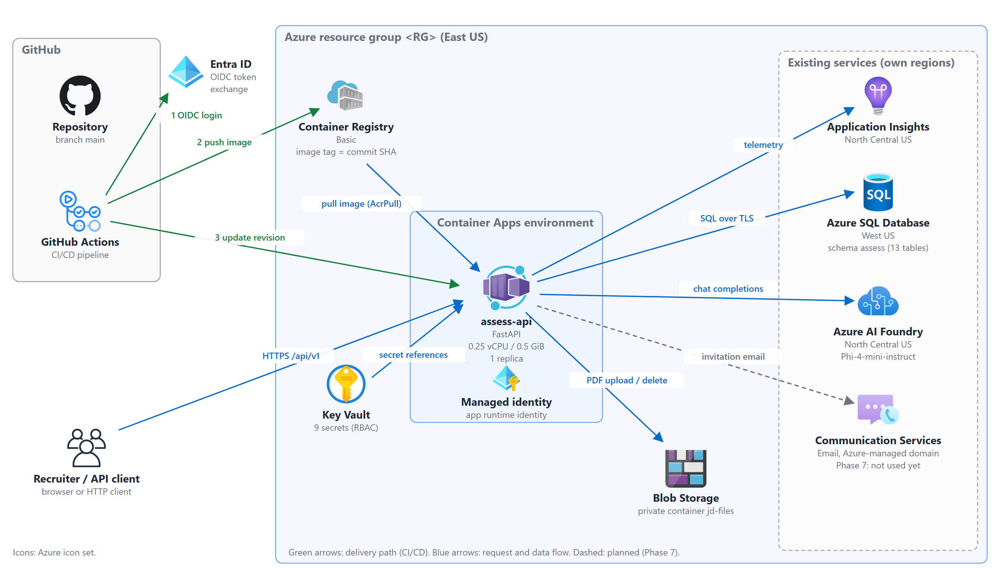

# AI Candidate Assessment Platform — Backend API

A multi-tenant REST API that lets recruiters create assessments from a job description, generate exam questions with an AI model, review and approve them, and (in later phases) invite candidates, run timed exams and score the results.

> **Public repository.** Never commit credentials, real Azure resource names, hostnames, subscription/tenant IDs or email addresses. Real names live only in the gitignored `config/azure.local.env`. Placeholders such as `<KV>` or `<SQL_SERVER>` are used everywhere else.

Legend: **🔁** = a command you must run on every new system. **⚠️ TO CONFIRM** = not verified yet; do not rely on it.

---

## 1. Overview

This repository holds the **backend only** (`api/`). The older portal folders `frontend/`, `backend/`, `database/` and `ai_service/` belong to a separate, existing project and are not part of this backend; do not modify them.

The API is a Python FastAPI service. Recruiters (tenant staff) authenticate with a session cookie, create assessments, optionally upload a job-description PDF, and ask the AI to generate questions. Generation runs as a background job inside the API process. Every tenant's data is isolated.

**Current status:** phases 0–6 of 13 are implemented and have been exercised against real Azure services (SQL, Blob, AI model, Application Insights), both from a developer laptop and from the deployed Container App. Phases 7–13 (participants and invitations, candidate exam, scoring, results/audit, hardening, full CI/CD gates, release) are not started. Details and evidence: [`docs/PROGRESS.md`](docs/PROGRESS.md) and [`docs/UNVERIFIED_AZURE_LEDGER.md`](docs/UNVERIFIED_AZURE_LEDGER.md). A full re-run of the 28 live checks against the deployed API, the rollback drill and the GitHub `live-e2e` run are still pending (⚠️ TO CONFIRM).

## 2. Tech stack

| Area | Technology |
|---|---|
| Language / runtime | Python 3.12 (container image and CI). The code requires Python ≥ 3.11 (`api/pyproject.toml`); 3.11 was used on the development laptop. |
| Web framework | FastAPI, Uvicorn, Pydantic v2 / pydantic-settings |
| Data access | SQLAlchemy 2 Core + pyodbc (ODBC Driver 18 for SQL Server); in-memory SQLite for offline runs |
| Security | Argon2id password hashing, signed `sid` session cookie, platform key for tenant creation |
| Database | Azure SQL (existing server, database schema `assess`) |
| Files | Azure Blob Storage (private container `jd-files`); PDF text via `pypdf` |
| AI | Azure AI Foundry — Microsoft Phi-4-mini-instruct deployment (OpenAI-compatible `v1` chat-completions route) |
| Email | Azure Communication Services Email (wired; real invitation delivery is Phase 7 and not yet proven) |
| Telemetry | Azure Application Insights (OpenTelemetry) |
| Secrets / identity | Azure Key Vault (RBAC), user-assigned managed identities, GitHub OIDC (no stored cloud passwords) |
| Hosting | Azure Container Apps (1 replica, 0.25 vCPU / 0.5 GiB), Azure Container Registry |
| CI/CD | GitHub Actions (lint, types, tests, SQL Server + Azurite + container tests, Trivy, gitleaks, deploy, rollback) |
| Quality tools | ruff, mypy, pytest |

## 3. Architecture at a glance

- One FastAPI service (`assess-api`) exposes `/api/v1/*`. Routes call services, services call repositories and **providers** (AI, email, files); each provider has a real Azure implementation and a fake for offline runs.
- Tenant isolation: the tenant always comes from the authenticated session, never from the request body; every repository query is tenant-scoped.
- Background jobs (question generation) run in-process from a database-backed queue with retries.
- The database schema is applied by an idempotent migration runner at startup, before the API accepts traffic.
- Production refuses fakes and the in-memory backend, and refuses weak or development secrets.



*Figure: Azure services and how they connect. Green: delivery path. Blue: request and data flow. Dashed: planned (Phase 7). Source and PDF: [`docs/ARCHITECTURE.pdf`](docs/ARCHITECTURE.pdf); rebuild with `python scripts/docs/build_architecture.py` (needs Chrome or Edge).*


## 4. Project structure

```text
.
├── AGENTS.md                     Working rules for the AI coding agent (read first by the agent)
├── README.md                     This file
├── azure_connection_1to6.md      Older office checklist (draft; superseded where it disagrees with the scripts)
├── pytest.ini / ruff.toml        Test and lint configuration
├── api/                          THE BACKEND
│   ├── Dockerfile                Image built on GitHub runners (Docker is not needed on laptops)
│   ├── requirements*.txt         Runtime and development dependencies
│   ├── .env.example              Template of settings (no secrets)
│   └── app/
│       ├── main.py               App factory, startup (migrations, job loop), error handlers, router wiring
│       ├── config.py             Settings from environment variables + production safety rules
│       ├── deps.py               FastAPI dependencies (repositories, auth, roles)
│       ├── middleware.py         Request id, security headers, body-size limit, access log
│       ├── telemetry.py          Application Insights setup
│       ├── routes/               HTTP endpoints (auth, platform, users, assessments, generation, health)
│       ├── schemas/              Request/response models
│       ├── services/             Business rules (auth, accounts, assessments, JD files, generation, questions)
│       ├── repositories/         Tenant-scoped data access (one implementation for SQL Server and in-memory)
│       ├── db/                   Engine, schema definition, column types
│       ├── migrations/           Runner + ordered T-SQL migrations (0001–0003)
│       ├── providers/            AI / email / files ports; Azure implementations and fakes
│       ├── ai/                   Prompt templates and strict validation of model output
│       ├── jobs/                 Background job engine and handlers
│       ├── security/             Password hashing, session cookie signing
│       ├── core/                 Clock, ids, logging, error types
│       └── tools/                Azure probe CLI, tenant seeding
├── tests/                        phase0 … phase6 test suites (+ shared helpers); SQL/Azurite/container tests run in CI
├── scripts/
│   ├── dev/                      Developer + provisioning scripts (setup, run, verify, secrets, provision, …)
│   ├── e2e/                      Live end-to-end harness (works against local or deployed API)
│   ├── ci/                       CI helpers (ODBC install, SQL preparation)
│   ├── docs/build_architecture.py  Draws the diagrams and builds docs/ARCHITECTURE.pdf
│   ├── db/create-app-user.sql    One-off: schema `assess` and least-privilege SQL user
│   └── run-plan.sh               Dry-run of the legacy provisioning scripts
├── config/azure.example.env      Template of private, non-secret Azure names (copy to azure.local.env)
├── infra/azure/                  Container App definition + legacy dry-run provisioning scripts
├── docs/                         Setup guide, progress report, architecture PDF (+ architecture/ sources, images/),
│                                 decisions, plan, progress, ledger, runbook, phase reports, prompts
└── .github/workflows/            deploy.yml (CI/CD), nightly, live-e2e, rollback, load-test
```

## 5. Documentation

| Document | Purpose |
|---|---|
| [`docs/PROGRESS.md`](docs/PROGRESS.md) | Where the work stands, phase by phase (the file that exists today) |
| [`docs/SETUP.md`](docs/SETUP.md) | Full setup on a new system (join the environment, or rebuild it), with the commands to run on every new system and troubleshooting |
| [`docs/PROGRESS_REPORT.md`](docs/PROGRESS_REPORT.md) | Step-wise progress report for management: steps, keys and keywords, phases and stages |
| [`docs/ARCHITECTURE.pdf`](docs/ARCHITECTURE.pdf) | Architecture and technical explanation (diagrams, database, deployment, CI/CD, API, layers) |
| [`docs/decisions.md`](docs/decisions.md) | Confirmed decisions and constraints (budget, regions, access rules) |
| [`docs/PROVISIONING_PLAN.md`](docs/PROVISIONING_PLAN.md) | The signed plan for every Azure resource and role |
| [`docs/UNVERIFIED_AZURE_LEDGER.md`](docs/UNVERIFIED_AZURE_LEDGER.md) | What is proven against real Azure and what is not |
| [`docs/data-model.md`](docs/data-model.md), [`docs/runbook.md`](docs/runbook.md), `docs/phase-reports/` | Data model, operations, per-phase reports |
| [`docs/OFFICE_CONNECTION_AND_TESTING_GUIDE.md`](docs/OFFICE_CONNECTION_AND_TESTING_GUIDE.md) | Older office-laptop guide; parts are superseded by the `scripts/dev` workflow — ⚠️ TO CONFIRM which sections |

## 6. Quick start

### 6.1 Prerequisites

| Tool | Version | Needed for |
|---|---|---|
| Git | any recent | clone |
| Python | 3.12 recommended (≥ 3.11 works) | everything |
| Azure CLI | 2.x (2.86 was used) | cloud-connected mode |
| ODBC Driver 18 for SQL Server | 18 | cloud-connected mode (Azure SQL); not needed offline |
| Docker | **not needed** | images are built on GitHub runners |

### 6.2 Clone and install (both modes)

```powershell
git clone https://github.com/Siddharajparkar/We_Select-.git
cd We_Select-
py -3.12 -m venv .venv            # or: python -m venv .venv
.\.venv\Scripts\Activate.ps1
python -m pip install --upgrade pip
pip install -r api\requirements-dev.txt
```

macOS/Linux: use `python3 -m venv .venv`, `source .venv/bin/activate` and `/` paths. ⚠️ TO CONFIRM: only Windows PowerShell was exercised during development.

### 6.3 Mode A — offline (no Azure, fakes and in-memory data)

```powershell
$env:ASSESS_IGNORE_ENV_LOCAL = "1"      # ignore a cloud-profile api\.env.local if one exists
cd api
python -m app.main
```

Defaults are `REPO_BACKEND=memory`, `AI_MODE=fake`, `EMAIL_MODE=fake`, `FILES_MODE=memory`. Data is lost on restart.

### 6.4 Mode B — against the real Azure services (team members)

1. 🔁 **Install ODBC Driver 18 for SQL Server** (e.g. `winget install --id Microsoft.msodbcsql.18 -e`), then open a new terminal.
2. 🔁 **Sign in to Azure:** `az login`
3. 🔁 **Get `config/azure.local.env`** from the project owner (private; it holds resource *names*, no keys) and place it in `config/`. Template: [`config/azure.example.env`](config/azure.example.env).
4. 🔁 **Get access:** the owner grants you the Key Vault role *Key Vault Secrets User* on the project's Key Vault. ⚠️ TO CONFIRM: there is no script for this yet; the owner uses `az role assignment create` with your identity, the role and the vault as scope.
5. 🔁 **Generate your local settings and run the probes** (pulls the nine secrets from Key Vault into the gitignored `api/.env.local`; values are never printed):
   ```powershell
   python scripts/dev/setup.py --add-ip
   ```
   `--add-ip` offers to add your current public IP to the SQL firewall; ⚠️ TO CONFIRM which Azure role a teammate needs for that. Re-run it whenever your network (and IP) changes.
6. **Start the API:**
   ```powershell
   python scripts/dev/run.py
   ```
7. **Verify (in a second terminal):**
   ```powershell
   python scripts/dev/verify.py            # add --no-ai to skip real AI calls
   ```

### 6.5 Verify it is running

```powershell
Invoke-RestMethod http://127.0.0.1:8080/api/v1/health
```
Expected: `status` = `ok`. The response carries an `x-app-version` header. Interactive API docs are at `http://127.0.0.1:8080/api/v1/docs` in development only (disabled in production).

## 7. Environment variables

Set as real environment variables, or (development only) in the gitignored `api/.env.local`, which is loaded outside production; real variables win. Production never loads that file. Values are never shown here. Template: [`api/.env.example`](api/.env.example).

| Variable | Purpose | Required |
|---|---|---|
| `APP_ENV` | `development`, `test` or `production` | optional (default development) |
| `PORT` | listen port (default 8080) | optional |
| `REPO_BACKEND` | `memory` or `sql` | optional; `sql` required in production |
| `DB_SCHEMA` | SQL schema (default `assess`) | optional |
| `DATABASE_URL` | Azure SQL connection string (ADO.NET style; `Connection Timeout` sets the login timeout) | required when `REPO_BACKEND=sql` |
| `SESSION_SECRET` | signs the session cookie (≥ 32 chars in production) | required in production |
| `PLATFORM_KEY` | authorises tenant creation (≥ 32 chars in production) | required in production |
| `COOKIE_SECURE` | `Secure` flag on the cookie; must be `true` in production | optional |
| `ARGON2_MEMORY_KIB`, `ARGON2_TIME_COST`, `ARGON2_PARALLELISM` | password hashing cost | optional |
| `AI_MODE` | `fake` or `azure` | `azure` in production |
| `FOUNDRY_ENDPOINT`, `FOUNDRY_KEY`, `FOUNDRY_DEPLOYMENT` | AI endpoint, key, deployment name | required when `AI_MODE=azure` |
| `FOUNDRY_API_STYLE` | `v1` or `azure-deployments` | required when `AI_MODE=azure` |
| `FOUNDRY_API_VERSION` | only for `azure-deployments` | optional |
| `AI_JSON_MODE` | send `response_format=json_object` (default true) | optional |
| `AI_MAX_OUTPUT_TOKENS`, `AI_TIMEOUT_SECONDS` | model call limits | optional |
| `AI_DAILY_TOKEN_CAP`, `DAILY_GENERATION_LIMIT` | per-tenant per-day usage guards | optional |
| `EMAIL_MODE` | `fake` or `azure` | `azure` in production |
| `ACS_CONNECTION_STRING`, `ACS_SENDER` | Communication Services connection and sender address | required when `EMAIL_MODE=azure` |
| `FILES_MODE` | `memory`, `azurite` or `azure` | `azure` in production |
| `BLOB_CONNECTION_STRING`, `BLOB_CONTAINER` | Blob Storage connection and container (default `jd-files`) | required when `FILES_MODE` is `azurite`/`azure` |
| `APPLICATIONINSIGHTS_CONNECTION_STRING`, `APPINSIGHTS_SAMPLING_PERCENT` | telemetry | optional |
| `APP_BASE_URL`, `API_INTERNAL_URL` | public and internal URLs | optional |
| `JOB_LOOP_ENABLED`, `JOB_MAX_CONCURRENT`, `JOB_TICK_SECONDS`, `JOB_STUCK_SECONDS`, `JOB_RETRY_BASE_SECONDS`, `JOB_SHUTDOWN_GRACE_SECONDS` | background job engine tuning | optional |
| `GIT_SHA`, `RETENTION_DAYS` | version reported in `x-app-version`; data retention | optional |
| `ASSESS_IGNORE_ENV_LOCAL`, `ASSESS_ENV_FILE` | skip, or relocate, the developer env file | optional |
| `E2E_PLATFORM_KEY` | platform key the live harness uses against a deployed API (`verify.py` supplies it) | harness only |
| `TEST_DATABASE_URL`, `AZURITE_CONNECTION_STRING`, `E2E_IMAGE` | CI test tiers (SQL Server, Azurite, container image) | CI only |

## 8. Scripts and commands

**Quality gates** (run from the repository root, venv active):

| Command | What it does |
|---|---|
| `ruff check api scripts tests` | lint |
| `ruff format --check api scripts tests` | format check |
| `cd api; mypy app` | type check |
| `pytest -m "not sql and not container and not azurite"` | local test suite (SQL/Azurite/container tiers run in CI) |

**Developer scripts** (`scripts/dev/`, cross-platform Python; each defaults to a dry run where it changes anything):

| Script | What it does |
|---|---|
| `setup.py [--check] [--add-ip] [--skip-probes]` | checks tools, pulls secrets from Key Vault into `api/.env.local`, runs the probes |
| `run.py [--check]` | starts the API with the cloud profile |
| `verify.py [--base-url URL] [--upto N] [--no-ai]` | runs the live checks (local or deployed API) |
| `put_secrets.py [--apply] [--rotate]` | owner: fills the nine Key Vault secrets (SQL password via hidden prompt) |
| `sync_secrets.py [--apply]` | owner: points the Container App's secrets at Key Vault |
| `configure_app.py [--apply]` | owner: applies the app's production settings |
| `provision.py <step> [--apply]` | owner: creates one Azure resource/role at a time (idempotent; needs the plan sign-off) |
| `github_settings.py` | prints the values to enter in GitHub (read-only) |

**Other tools:**

| Command | What it does |
|---|---|
| `python -m app.tools.probe <config\|sql\|blob\|foundry\|insights\|acs\|all>` (from `api/`) | connectivity probes; never prints secrets |
| `python -m app.migrations.runner` (from `api/`) | applies migrations |
| `python -m app.tools.seed_tenant --name "Acme" --admin-name "Ada" --admin-email ada@example.com` (from `api/`) | creates a tenant and its first admin; the password is read from stdin or a hidden prompt |
| `python scripts/e2e/run.py --base-url URL --upto 6 [--target local\|azure] [--with-ai true]` | the live end-to-end harness |
| `bash scripts/e2e/smoke.sh` | post-deploy smoke test (health + version) |

## 9. API reference (summary)

All routes are under `/api/v1`. Interactive docs (development only): `/api/v1/docs`. Details: section 8 of [`docs/ARCHITECTURE.pdf`](docs/ARCHITECTURE.pdf).

| Group | Endpoints |
|---|---|
| Health | `GET /health` |
| Auth | `POST /auth/login`, `POST /auth/logout`, `GET /auth/me` |
| Platform | `POST /platform/tenants` (requires the platform key) |
| Users | `GET /users`, `POST /users`, `PATCH /users/{id}` |
| Assessments | `POST/GET /assessments`, `GET/PATCH/DELETE /assessments/{id}`, `POST /assessments/{id}/jd-file`, `POST /assessments/{id}/close` |
| Question generation | `POST /assessments/{id}/generate`, `GET /jobs/{id}`, `GET/POST /assessments/{id}/questions`, `PATCH/DELETE /questions/{id}`, `POST /questions/{id}/regenerate`, `POST /assessments/{id}/approve` |

Participants, candidate exam, scoring, results and audit endpoints are planned (phases 7–10).

## 10. Deployment and CI/CD

- **Workflow** `.github/workflows/deploy.yml` runs on pushes to `main`, `phase/**` and `feature/**` and on pull requests to `main` (pushes that change only `docs/**` or `*.md` files do not run it): **fast** (lint, types, tests) → **container** (SQL Server, Azurite, image build and container tests, Trivy) → **security** (gitleaks, pip-audit) → **deploy**.
- **Deploy** runs only on `main` and only when the repository variable `AZURE_DEPLOY_ENABLED` is `true`. It logs in to Azure with GitHub OIDC (no stored cloud password), builds the image on the runner, pushes it to Azure Container Registry tagged with the commit SHA, updates the Container App, and smoke-tests that the new revision reports that SHA. A failed smoke test rolls back to the previous image.
- Other workflows: `nightly.yml` (daily at 02:00 UTC and on demand), `live-e2e.yml` (manual), `rollback.yml` (manual, takes an image tag), `load-test.yml` (manual).
- The Container App reads its secrets as Key Vault references through its own managed identity.
- Details: sections 6 and 7 of [`docs/ARCHITECTURE.pdf`](docs/ARCHITECTURE.pdf); see also [`docs/runbook.md`](docs/runbook.md) and [`docs/PROVISIONING_PLAN.md`](docs/PROVISIONING_PLAN.md).

## 11. Troubleshooting

| Symptom | Likely cause and fix |
|---|---|
| `setup.py` reports `ODBC Driver 18 … not found` | Install ODBC Driver 18 for SQL Server and open a new terminal. |
| `az login` fails with `AADSTS530035` (security defaults) | A tenant security policy; sign in to the Azure portal first and complete MFA registration, then retry `az login` from your own terminal. |
| SQL probe: `Client with IP address … is not allowed` | Your public IP changed. Re-run `python scripts/dev/setup.py --add-ip` (or ask the owner to add it). |
| SQL probe times out on the first connection | The serverless database auto-pauses and takes up to about a minute to resume; retry once. |
| `Azure refused access` when pulling secrets | You lack the Key Vault Secrets User role; ask the owner. |
| Tests that run scripts fail on Windows with “No such file or directory” | `bash` on PATH is WSL; the tests look for Git for Windows' Git Bash instead. Install Git for Windows. |
| `pytest` fails `test_no_hardcoded_secrets_in_tracked_files` | A non-test file assigns a variable named like `key`, `secret`, `token` or `password` from a plain word; rename the variable. |
| `git push` rejected: “would publish a private email address” | Commit with your GitHub `noreply` address (`git config user.email`) or relax the setting in GitHub's email settings. |
| Port 8080 already in use | Stop the other process or set `PORT`. |

Full list: section 5 of [`docs/SETUP.md`](docs/SETUP.md).
